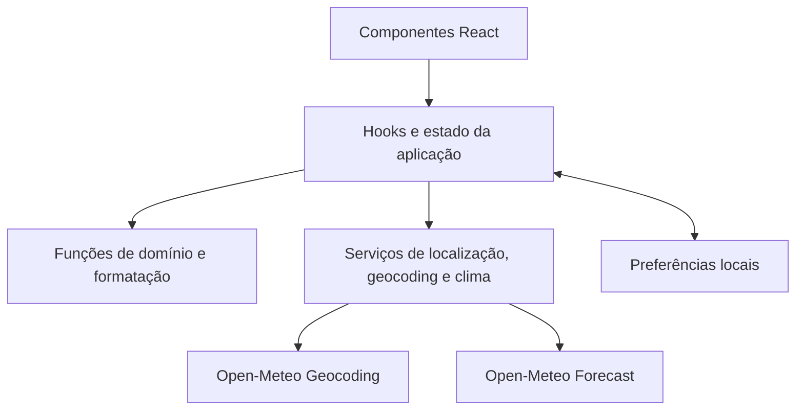
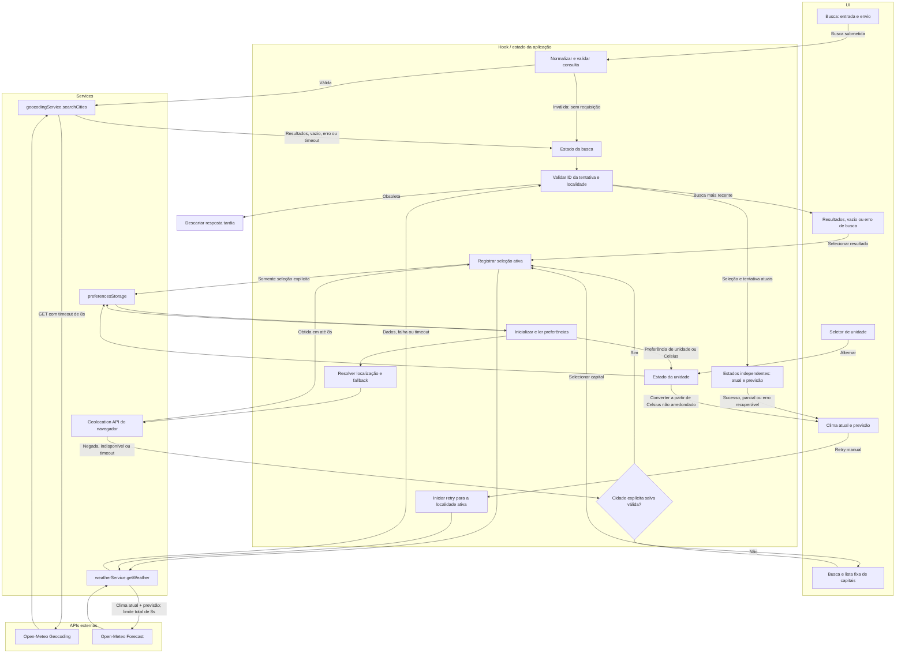

# Plano Técnico — Weather App

Este plano deriva de `specs/weather-app-spec.md`. Ele define arquitetura e contratos para orientar a decomposição em tarefas; não aprova a Open-Meteo para produção nem substitui os gates da seção 9 da especificação.

## 1. Architecture Overview

SPA React com fluxo unidirecional e separação entre apresentação, orquestração, domínio e integração externa:



- **Apresentação (`components/`)**: busca, opções de localidade, cartões de capitais, clima atual, previsão, seletor de unidade, estados de carregamento/erro/vazio e atribuição global da fonte. Componentes recebem dados e ações por props.
- **Orquestração (`hooks/`)**: coordena localização inicial, seleção, buscas concorrentes, consultas meteorológicas, tentativas e persistência. A seleção de localidade é a chave de associação de todo dado apresentado.
- **Domínio (`lib/`)**: validação e normalização de consulta, cálculos de datas locais, conversão e arredondamento de temperatura, mapeamento de códigos meteorológicos e formatação pt-BR. Funções puras, sem `fetch` ou acesso direto ao navegador.
- **Integração (`services/`)**: adaptadores para Geocoding e Forecast, normalização de respostas, timeout, cancelamento e erros tipados.
- **Persistência**: adaptador pequeno sobre `localStorage`, isolado para que falhas ou conteúdo inválido não impeçam a inicialização.
- **Atribuição**: rodapé global renderizado pelo shell da aplicação. Texto e link vêm do gate de termos aprovado; a publicação fica bloqueada enquanto esse conteúdo não estiver confirmado.

Clima atual e previsão são carregados em paralelo e têm estados de seção independentes. O prazo total da atualização começa na seleção e é de oito segundos; a expiração encerra a tentativa visível, aborta o que for possível e ignora conclusões tardias. As capitais aparecem sem aguardar o clima e cada cartão carrega seus dados separadamente.

## 2. Tech Stack

| Área | Tecnologia | Uso no plano |
| --- | --- | --- |
| Linguagem | TypeScript strict | Tipos para contratos externos, estados e dados parciais. |
| UI e build | React + Vite | SPA responsiva; dependências já definidas pelo projeto. |
| Estilo | Tailwind CSS | Implementação visual conforme o tema e os padrões existentes. |
| Testes unitários/componentes | Vitest + Testing Library | Domínio, adaptadores, hooks e estados acessíveis. |
| Testes E2E | Playwright | Fluxos completos, teclado e viewports definidos na spec. |
| Auditoria de acessibilidade E2E | `@axe-core/playwright` | Verificações automatizadas WCAG 2.2 AA nos estados principais; dependência somente de teste. |
| Dados candidatos | Open-Meteo Geocoding e Forecast | Sem chave de API; uso em produção condicionado aos quatro gates da spec. |
| Qualidade | Biome | Lint e formatação conforme configuração do repositório. |

Não adicionar biblioteca de estado global: o estado pertence à aplicação e pode ser coordenado por hooks React. Dependências adicionais só são justificadas se um contrato da fonte ou a compatibilidade dos navegadores exigir isso.

## 3. Project Structure

Estrutura proposta, compatível com as convenções do projeto:

```text
src/
├── components/
│   ├── SearchBar.tsx
│   ├── SearchResults.tsx
│   ├── CapitalList.tsx
│   ├── CapitalWeatherCard.tsx
│   ├── CurrentWeather.tsx
│   ├── ForecastList.tsx
│   ├── ForecastDay.tsx
│   ├── UnitToggle.tsx
│   ├── SourceAttribution.tsx
│   └── states/
├── hooks/
│   ├── useWeatherApp.ts
│   └── useGeolocation.ts
├── services/
│   ├── geocodingService.ts
│   ├── weatherService.ts
│   └── preferencesStorage.ts
├── lib/
│   ├── query.ts
│   ├── temperature.ts
│   ├── localDates.ts
│   ├── weatherCodes.ts
│   └── format.ts
├── types/
│   ├── location.ts
│   ├── weather.ts
│   └── preferences.ts
└── App.tsx
```

Os nomes são uma divisão inicial, não uma exigência de criar cada arquivo antecipadamente. A implementação deve manter componentes focados e evitar abstrações sem reutilização real.

## 4. Data Model

Contratos internos conceituais. Os valores de temperatura são normalizados para Celsius antes de serem armazenados em estado; campos não fornecidos permanecem `null`, nunca viram zero ou valor inferido.

```ts
type TemperatureUnit = 'celsius' | 'fahrenheit';
type WeatherOrigin = 'model' | 'observation' | 'unclassified';

interface Location {
  id: string;
  name: string;
  admin1: string | null;
  country: string | null;
  latitude: number;
  longitude: number;
  source: 'geocoding' | 'device' | 'capital';
}

interface CurrentConditions {
  temperatureC: number | null;
  apparentTemperatureC: number | null;
  minimumTodayC: number | null;
  maximumTodayC: number | null;
  conditionCode: number | null;
  sourceTimestamp: string | null;
  timeZone: string | null;
  origin: WeatherOrigin;
}

interface ForecastDay {
  localDate: string;
  conditionCode: number | null;
  minimumC: number | null;
  maximumC: number | null;
  precipitationMm: number | null;
  precipitationProbabilityPercent: number | null;
  meanHumidityPercent: number | null;
  maximumWindKmh: number | null;
}

interface WeatherSnapshot {
  locationId: string;
  current: CurrentConditions | null;
  currentReceivedAt: number | null;
  forecast: ForecastDay[];
  forecastReceivedAt: number | null;
}

interface SavedPreferences {
  schemaVersion: 1;
  unit: TemperatureUnit;
  lastExplicitLocation: Location | null;
}
```

Regras do contrato:

- Resultado de geocoding inclui apenas as propriedades geográficas disponíveis, mantendo `admin1` e `country` opcionais como `null`; coordenadas precisam ser válidas.
- A origem `device` identifica “Minha localização” na UI. Essa localidade não substitui `lastExplicitLocation` no armazenamento.
- `origin: 'model'` permite o rótulo “Estimativa”; “Observado” só é permitido com declaração explícita verificável da fonte. `unclassified` não autoriza nenhum desses rótulos.
- O timestamp e o instante de recebimento são preservados para classificar atualidade. `WeatherSnapshot.locationId` impede associar dados de outra seleção.
- A previsão contém exatamente cinco posições, mesmo quando alguns ou todos os campos de um dia estão indisponíveis.

## 5. Data Flow

1. Na inicialização, ler a unidade e a última localidade explícita de forma tolerante a falhas; valores inválidos resultam em Celsius e ausência de localidade salva.
2. Consultar o estado de permissão quando disponível. Se previamente negada, não solicitar novamente automaticamente. Caso contrário, iniciar a obtenção de coordenadas com limite de oito segundos. Resposta posterior ao prazo ou a uma seleção concorrente é descartada.
3. Se a localização for obtida a tempo, selecioná-la como “Minha localização” e iniciar o clima. Se falhar, restaurar a localidade explícita salva e buscar dados novos; sem uma localidade válida, mostrar busca e a lista fixa de capitais na ordem da spec.
4. Ao submeter a busca, normalizar com trim, NFC e redução de espaços internos; contar clusters Unicode percebidos pelo usuário e exigir ao menos dois, com uma letra ou número. Consulta inválida não chama o serviço. Cada busca ganha um identificador e um `AbortController`; somente a busca mais recente pode publicar resultados, erros ou timeout.
5. A seleção explícita de um resultado ou capital atualiza a localidade, salva apenas seus dados necessários para nova consulta e inicia a atualização meteorológica. Uma seleção mais recente invalida as tentativas anteriores.
6. Consultar clima atual e previsão em paralelo, com estados independentes e prazo comum de oito segundos. A consulta do clima atual inclui também as mínimas e máximas diárias da data local atual; assim, esses campos continuam disponíveis mesmo se a consulta da previsão falhar. Exibir seções/campos válidos conforme chegam; não substituir campo ausente por dado de outra data ou localidade. Uma resposta em andamento pode manter snapshot anterior apenas se `locationId` for igual, marcado como anterior e com o horário de recebimento da seção.
7. Para as capitais, renderizar a lista fixa imediatamente e iniciar uma consulta atual independente por cartão. Aplicar limite de oito segundos por cartão; falha ou timeout afeta apenas aquele cartão.
8. A unidade é aplicada na apresentação a partir do valor Celsius não arredondado. A alternância não gera nova consulta meteorológica.



## 6. External APIs

### Geocoding

```text
GET https://geocoding-api.open-meteo.com/v1/search?name={cidade}&count=5&language=pt&format=json
```

Substituir `{cidade}` pela consulta normalizada e codificada como parâmetro de URL. Validar a consulta antes da chamada. Mapear `results` para `Location`, mostrando nome, divisão administrativa e país quando disponíveis. Lista vazia é estado sem correspondência; HTTP 429, indisponibilidade, resposta inválida e timeout são erro recuperável, não estado vazio.

### Forecast

```text
GET https://api.open-meteo.com/v1/forecast?latitude={lat}&longitude={lon}&current=temperature_2m,apparent_temperature,weather_code&daily=weather_code,temperature_2m_min,temperature_2m_max,precipitation_sum,precipitation_probability_max,wind_speed_10m_max&hourly=relative_humidity_2m&temperature_unit=celsius&wind_speed_unit=kmh&precipitation_unit=mm&timezone=auto&forecast_days=5
```

`{lat}` e `{lon}` são as coordenadas da localidade selecionada. Os parâmetros `current`, `daily` e `hourly` definem os campos consumidos; `temperature_unit=celsius`, `wind_speed_unit=kmh` e `precipitation_unit=mm` tornam explícitas as unidades esperadas. `timezone=auto` solicita o fuso da coordenada e `forecast_days=5` cobre hoje e os quatro dias seguintes. Fazer duas chamadas independentes para a localidade selecionada: clima atual com `current=temperature_2m,apparent_temperature,weather_code`, `daily=temperature_2m_min,temperature_2m_max`, `temperature_unit=celsius`, `timezone=auto` e `forecast_days=1`; previsão com todos os grupos indicados na URL acima. Isso obtém os extremos da data local de hoje e preserva estados/falhas independentes sem duplicar os campos da previsão completa na consulta atual. A umidade média diária é calculada a partir dos valores horários disponíveis daquele dia; probabilidade máxima, precipitação acumulada e vento máximo usam agregados diários semanticamente equivalentes.

Usar o fuso IANA retornado pela fonte e validar que pode ser usado. As datas da previsão são chaves de calendário local, não timestamps interpretados no fuso do dispositivo. Construir hoje e os quatro dias seguintes no fuso da localidade; mapear os dados pela data retornada. Lacunas preservam sua posição e deixam campos indisponíveis. Sem fuso válido, a previsão fica indisponível e pode ser tentada novamente.

`current.time` é interpretado com o fuso IANA da resposta. O rótulo “Atual” exige timestamp válido, não futuro, e idade de no máximo três horas medida no recebimento; acima disso, “Desatualizado”. Sem timestamp ou fuso válido, não afirmar atualidade. Os campos e metadados exatos, semântica de agregados, unidades, atribuição e limites precisam ser confirmados nos gates 1–4 antes do release; não presumir que a API fornece classificação de observação.

## 7. State Management

Manter estado local da aplicação em hook de orquestração, separado por domínio e seção. Forma indicativa:

```ts
type AsyncStatus = 'idle' | 'loading' | 'success' | 'empty' | 'error' | 'partial' | 'unavailable';

interface AsyncSection<T> {
  status: AsyncStatus;
  data: T | null;
  error: string | null;
  receivedAt: number | null;
  attemptId: number | null;
}

interface WeatherAppState {
  query: string;
  search: {
    status: AsyncStatus;
    results: Location[];
    message: string | null;
    validationMessage: string | null;
    attemptId: number | null;
  };
  location: Location | null;
  current: AsyncSection<CurrentConditions>;
  forecast: AsyncSection<ForecastDay[]>;
  capitalWeather: Record<string, AsyncSection<CurrentConditions>>;
  unit: TemperatureUnit;
  locationStatus: 'checking' | 'success' | 'denied' | 'unavailable' | 'timeout' | 'idle';
}
```

`validationMessage` representa erro síncrono de entrada e não altera o status assíncrono da busca. `capitalWeather` é indexado pelo ID estável de cada capital fixa; cada seção mantém status, tentativa e recebimento próprios. O recebimento é registrado por seção para que dados anteriores mostrem o horário correto mesmo quando atual e previsão terminam em instantes diferentes.

- Estados assíncronos devem carregar o identificador da tentativa ativa; reducer/guardas ignoram respostas que não correspondam à tentativa e à localidade atuais.
- `AbortController` reduz trabalho desnecessário, enquanto identificadores de tentativa garantem descarte lógico mesmo quando o transporte não puder ser cancelado.
- Busca, localização, consulta meteorológica e cada cartão de capital têm ciclos de vida e timeouts próprios, sem retries automáticos ilimitados.
- A preferência de unidade persiste em cada alteração. A cidade persistida muda somente após seleção explícita de resultado ou card.
- Armazenamento é versionado e validado na leitura; exceções de acesso, JSON inválido, schema desconhecido ou coordenadas inválidas não bloqueiam a aplicação.
- Dados meteorológicos podem permanecer em memória somente durante a sessão. Nunca reutilizar snapshot de outra localidade como dado atual.

## 8. Error Handling Strategy

- **Inicialização/localização:** mostrar estado de obtenção; em negação, indisponibilidade ou timeout, seguir a precedência cidade salva válida → busca e lista fixa. Não repetir automaticamente permissão negada.
- **Entrada de busca inválida:** orientar correção junto ao campo, sem chamada de rede e sem mensagem de “nenhum resultado”.
- **Busca sem resultados:** estado vazio específico com consulta editável. **Erro/timeout/429:** mensagem de serviço temporariamente indisponível e ação manual para repetir a mesma consulta.
- **Clima em carregamento:** feedback imediato na interação. Em falha/timeout, ação para tentar novamente a mesma localidade. Respostas tardias não mudam UI nem armazenamento.
- **Falha parcial:** manter a seção carregada e marcar a outra como erro ou indisponível; dentro do prazo, dados válidos permanecem visíveis. Campos ausentes mostram “Indisponível” individualmente e a resposta incompleta é identificada como parcial.
- **Dados anteriores:** conservar apenas dados da mesma localidade durante atualização, identificados como anteriores e com horário da atualização. Em mudança de localidade, limpar o conteúdo meteorológico anterior.
- **Cards de capitais:** estados por cartão; timeout ou falha não remove nem bloqueia os demais. Sem resposta real, não renderizar condição ou temperatura inventada.
- **Datas e atualidade:** não inferir fuso do dispositivo, não deslocar valores entre datas e não rotular timestamp ausente, futuro ou inválido como atual.
- **Acessibilidade:** mensagens e mudanças de estado anunciáveis por tecnologia assistiva; erros e retry acessíveis por teclado, com foco lógico e visível.

## 9. Testing Strategy

### Vitest + Testing Library

- **Domínio:** normalização NFC/espaços, consulta vazia/curta/sem letras ou números e contagem de clusters Unicode; conversão C/F sem perda por conversões sucessivas e arredondamento de empate para longe de zero; limites de idade do timestamp, futuro/inválido; datas locais em fusos e transição de dia; agregação diária e preservação de cinco posições.
- **Serviços:** respostas válidas e parciais, campos ausentes, resultados vazios, erro HTTP/429, JSON inválido, timeout e cancelamento. Verificar que unidades e metadados são mapeados corretamente.
- **Hooks/estado:** precedência da localização sobre cidade salva, restauração após falha, ausência de persistência de coordenadas do dispositivo, isolamento por localidade, respostas fora de ordem e descarte de resultado/erro tardio.
- **Componentes:** estados inicial, loading, vazio, erro, parcial e indisponível; validação de entrada sem requisição; unidade em todos os valores; extremos de hoje independentes da previsão; cards isolados; atribuição global presente; nomes acessíveis e interação por teclado.

Usar `fetch` e relógio controlados nos testes para reproduzir prazos e ordem de resposta sem depender da rede real.

### Playwright

- Fluxo de busca, desambiguação e seleção; localização concedida/negada e fallback; cards fixos e falha isolada; clima atual, cinco dias e alternância de unidade; persistência ao recarregar; recuperação de erro/429 e proteção contra respostas obsoletas.
- Testar layouts nos viewports de 360, 768, 1024 e 1440 CSS px e em larguras intermediárias relevantes, confirmando ausência de rolagem horizontal.
- Executar os fluxos principais em Chromium, Firefox e WebKit na CI. No gate de release, fazer smoke test nos navegadores exigidos pela RNF2: versão estável atual e anterior de Chrome, Edge, Firefox e Safari desktop, além de Chrome para Android e Safari para iOS ainda suportados; registrar as versões. O smoke test cobre busca, seleção, consulta, erro/retry e unidade, sem repetir toda a suíte em cada combinação.
- Usar `@axe-core/playwright` como dependência somente de teste para verificar WCAG 2.2 AA nas telas inicial, carregada e de erro/parcial. Complementar com checagem de contraste, teclado, foco visível, anúncio de estados e `prefers-reduced-motion`; verificar também formatação pt-BR e presença/link da atribuição aprovada.
- Interceptar endpoints com `page.route` para respostas determinísticas; não tornar a suíte dependente da disponibilidade da Open-Meteo.

## 10. Risks & Trade-offs

| Risco/decisão | Impacto | Tratamento |
| --- | --- | --- |
| Termos, atribuição, semântica de campos ou limites da Open-Meteo ainda não aprovados | Alto; bloqueia publicação com esta fonte | Completar e documentar todos os gates da spec. Se algum falhar, rever o provedor; o plano não declara conformidade antecipada. |
| Consultas independentes para atual e previsão, além das consultas dos dez cards | Pode elevar uso e atingir limites do provedor | Consultar em paralelo para suportar falha parcial; validar volume e limites no gate operacional e ajustar estratégia sem perder estados independentes. |
| Umidade média exige amostras horárias se não houver agregado diário equivalente | Amostras ausentes podem tornar o valor parcial | Usar média apenas dos valores disponíveis do dia; se nenhum existir, mostrar indisponível. Validar semântica no gate de previsão. |
| Datas e timestamp dependem de fuso IANA coerente | Erro pode deslocar dia ou rotular dado incorretamente | Validar fuso, fixar relógio nos testes e nunca usar fuso do dispositivo como fallback. |
| Geolocation Permissions API pode variar por navegador | Estado de permissão pode não ser consultável uniformemente | Isolar acesso ao navegador; tratar resultado/erro real da geolocalização e timeout sem bloquear busca manual. Validar matriz de compatibilidade da spec. |
| Cancelamento de rede não garante cancelamento da conclusão | Resultado antigo pode sobrescrever seleção nova | Guardar identificadores monotônicos de busca/seleção e verificar antes de cada atualização de estado ou persistência. |
| Cache em sessão melhora recuperação, mas pode parecer atual | Risco de atribuição incorreta ou informação vencida | Associar por ID de localidade, instante de recebimento e rótulo explícito de dado anterior; não persistir clima entre sessões. |
| Contagem de caracteres percebidos depende de segmentação Unicode | Implementações por code point não atendem todos os graphemes | Usar segmentação por grapheme (`Intl.Segmenter`) e incluir casos com emoji/combining marks nos testes de validação, sem enviar consultas inválidas. |

### Rastreabilidade e gates

- **Busca, seleção, localização, capitais e concorrência:** RF1, RF6; US1-CA01–US1-CA14; RNF1–RNF7.
- **Clima atual, timestamp, parcialidade, origem e atribuição:** RF2, RF6; US2-CA01–US2-CA09; RNF1–RNF7.
- **Cinco datas locais e agregados diários:** RF3, RF6; US3-CA01–US3-CA06; RNF1–RNF6.
- **Conversão e persistência:** RF4, RF5; US4-CA01–US4-CA05; RNF1, RNF2, RNF3, RNF5 e RNF7.
- **Timeout, retries e restauração:** RF1, RF2, RF3, RF5 e RF6; US5-CA01–US5-CA09; RNF3, RNF4, RNF6 e RNF7.
- **Acessibilidade, compatibilidade e responsividade:** RNF1–RNF3; validar a suíte automatizada e o smoke test da matriz de release antes de publicar.
- Antes de publicar com Open-Meteo, registrar aprovação de: termos/atribuição; contrato do clima atual; contrato e semântica da previsão; limites operacionais e compatibilidade com os prazos. Gate não aprovado significa que a fonte continua candidata e não pode ser declarada conforme.